# dopamine-diagrams

[日本語](README.md) | **English**

An agent skill (Claude Code and other `SKILL.md`-compatible agents) for explainer diagrams that people stop
scrolling for.

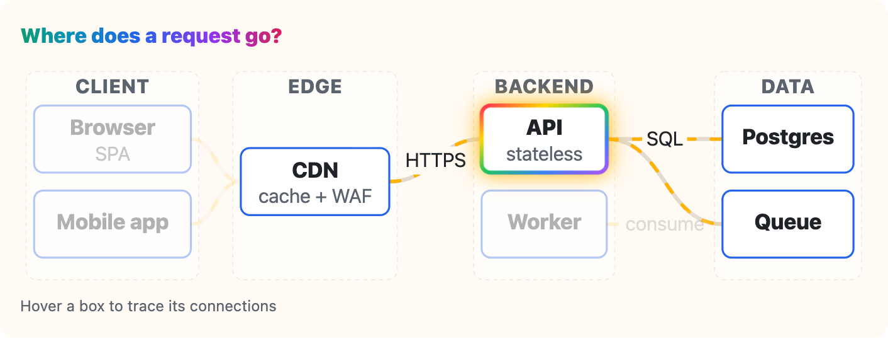

Titles carry a flowing rainbow gradient, key words glow in gold, a rainbow light runs around the one box that
matters, and answers stamp in when you click.

Pure HTML + CSS. One JSON spec builds to:

- a **Zenn `html-embed`** block (JavaScript is banned there; everything here works without it),
- a **standalone HTML** page,
- a **16:9 slide deck** that prints to PDF.

## Patterns

Eight of them. Every image below is a sample from [examples/en/](examples/en/) at Zenn's article width (706px).
The Japanese samples are in [examples/](examples/).

### architecture: components in tiers, and how a request flows

Light flows along the edges. Hover a box and only its connections light up (the image at the top).

### explorer: "in situation X, do Y (not Z)"

Pick a situation: the common mistake is struck through and the answer stamps in inside a rainbow border. Each situation can carry an importance badge (1-4 stars and a word).

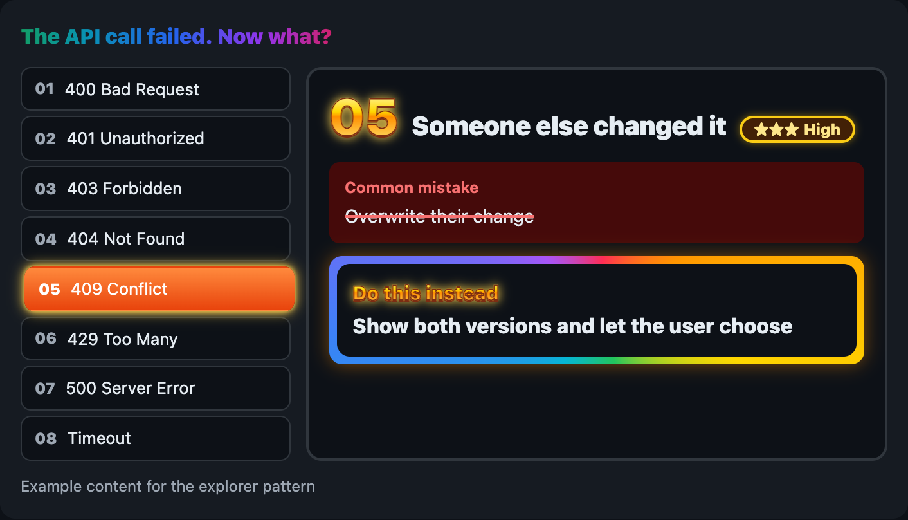

### decompose: a vague statement becomes concrete items

Click to break it down. The pieces appear one by one, then a gold stamp lands.

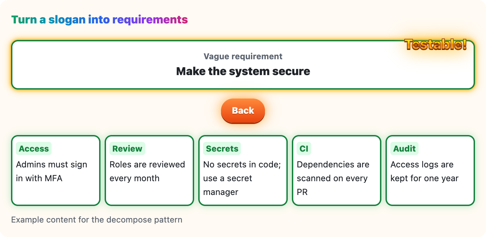

### compare: the habit vs. the better way

Click to flip "before" into "after".

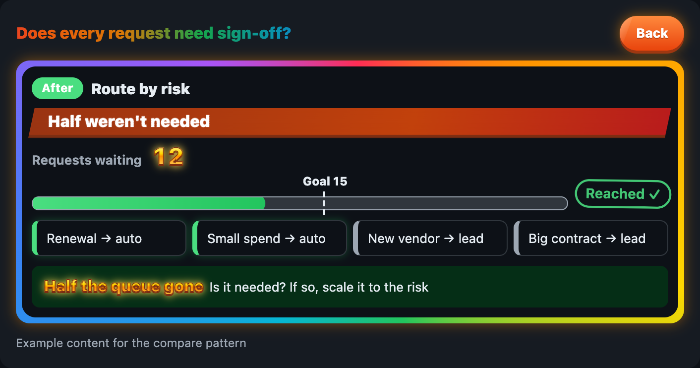

### loop: a cycle that repeats, and when to restart from the goal

Light runs round the ring. The dotted arrow is the way back when the goal changes.

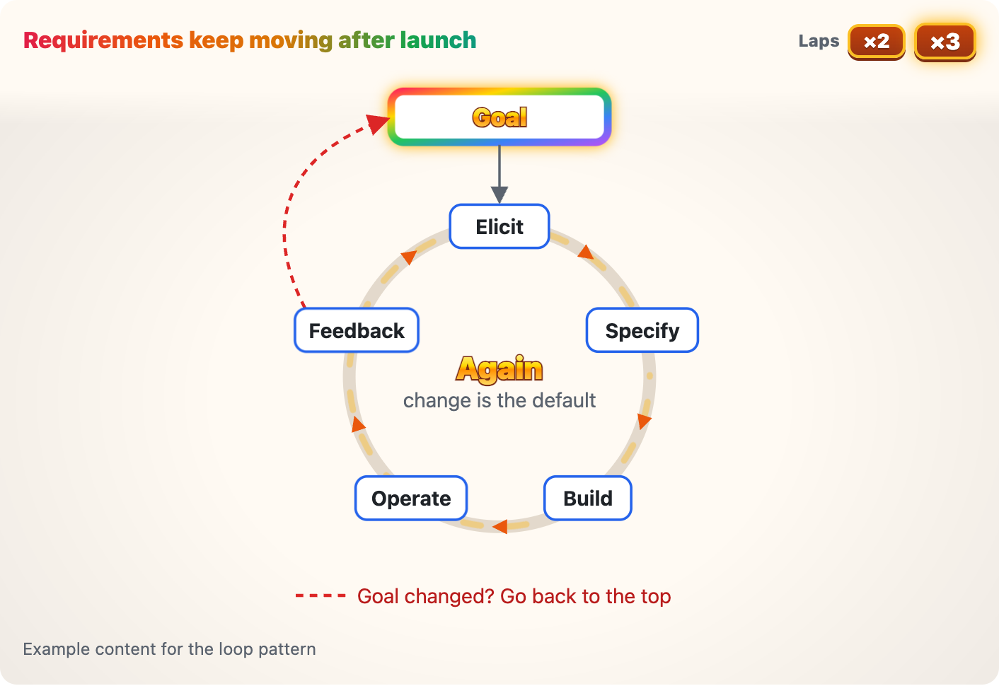

### flow: linear steps

Light runs along the line. Pick a step to read it.

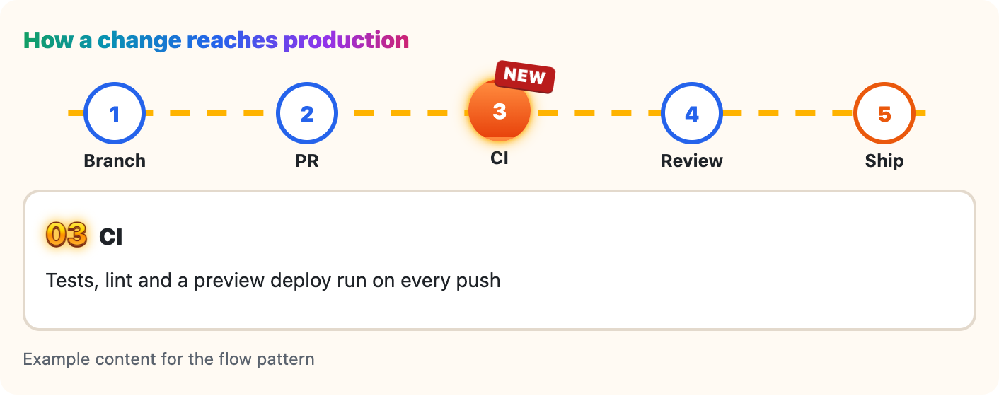

### ladder: levels, maturity, staged plans

Pick your level: the levels below light up one by one with a ✓, and the next move appears in gold.

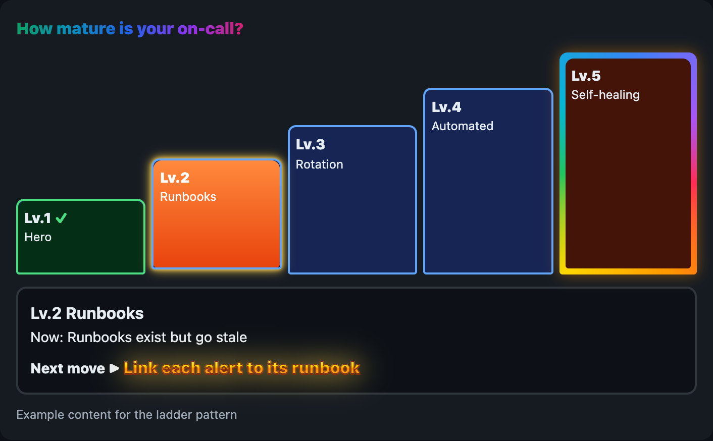

### proportion: the rare case the average hides

One click fades 99 dots and lights up the one that matters.

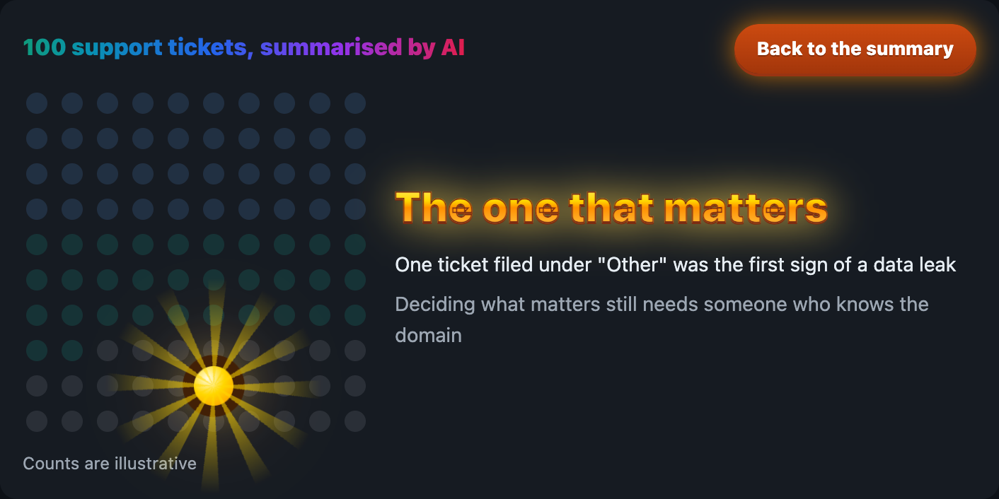

## Phones and slides

Narrow screens get a vertical layout. Zenn embeds switch at 560px (see "Notes for Zenn" below).

<p>
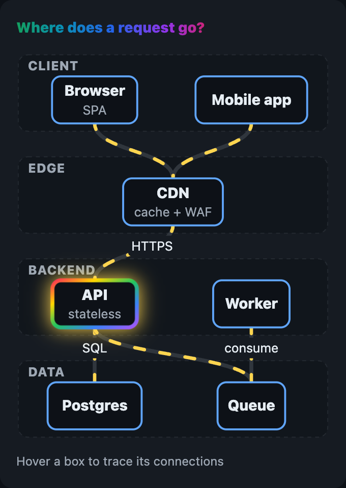
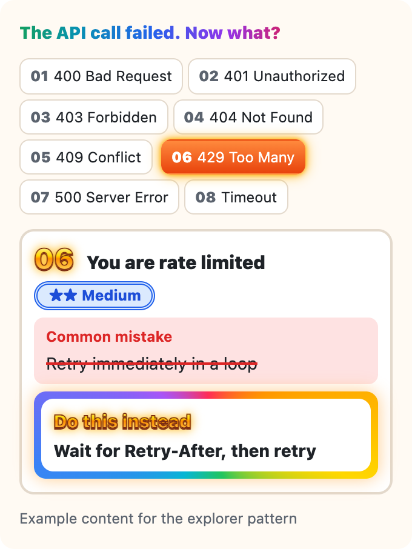
</p>

Slides are 1280×720px each and print straight to PDF.

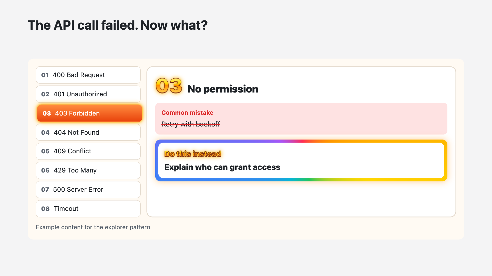

## Intensity

`--intensity` picks one of three levels. From the left: `1` (calm, for internal docs and conservative decks),
`2` (standard), `3` (full).

<p>
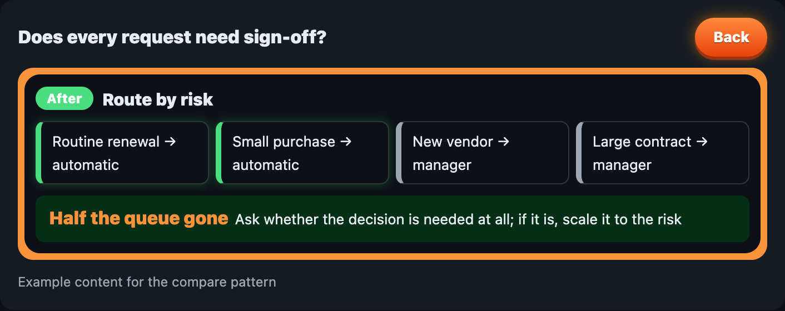

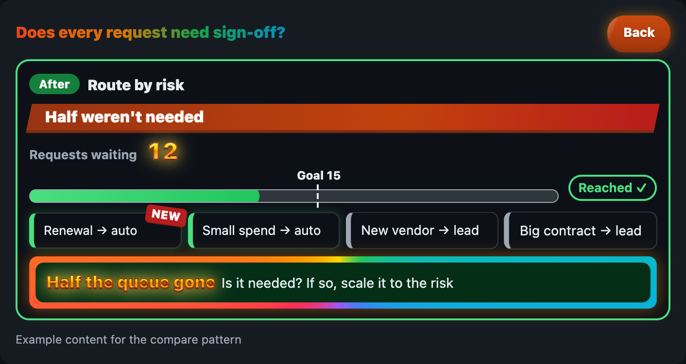
</p>

## Install

```sh
git clone https://github.com/muroshima/dopamine-diagrams ~/.claude/skills/dopamine-diagrams
cd ~/.claude/skills/dopamine-diagrams && npm run setup   # optional: for the checker (uses your installed Chrome)
```

Then ask your agent, e.g. "make our on-call escalation rules into a dopamine-diagrams explorer for Zenn". It
follows `SKILL.md`: pick the target and pattern, write a JSON spec, build, check, look at the screenshots.
`SKILL.md` is in Japanese; the English version is [SKILL.en.md](SKILL.en.md) with references in
[references/en/](references/en/).

## Use the scripts directly

```sh
python3 scripts/build.py examples/en/explorer.json --target zenn -o out.md
python3 scripts/build.py examples/en/*.json --target slides -o deck.html
python3 scripts/build.py examples/en/*.json --target standalone -o page.html --intensity 3
node scripts/check.mjs out.md --shots .check/out
node scripts/check.mjs deck.html --pdf deck.pdf
```

`build.py` needs only Python 3 (`py` instead of `python3` on Windows). It stops with a message when a spec is
missing a field, points at an unknown node id, or contains a value that would break the output. Default UI
words (button labels and so on) are Japanese when the spec has hiragana or katakana and English otherwise;
set `"lang": "en"` or `"lang": "ja"` to choose. Japanese written only in kanji counts as English, so add
`"lang": "ja"` there.

`check.mjs` needs Node 18+, `npm run setup` (playwright-core) and Google Chrome stable; set
`CHROME_PATH=/path/to/chrome` for Chromium or another build. Without them it runs the static checks only and
says so.

The checker opens the output in Chrome and clicks every state at every width. It fails on horizontal overflow,
text under 12px, the 500px Zenn height limit, and animation loops fast enough to count as flashing.
`--shots DIR` also saves screenshots.

## Effect rules

- Only one or two spots per diagram glow. Light everything and it is just noise.
- No flashing. No loop faster than 0.5s; glow eases in and out over 1s or more (Zenn bans flashing embeds;
  WCAG 2.3.1).
- Viewers who ask for reduced motion, and print, get no motion at all, and everything is still readable.
- Rendered text is at least 12px, including scaled SVG text. Colour is never the only signal.

## Notes for Zenn

Zenn documents 640px as its breakpoint. Measured on a live article, the embed is 706px wide on 1440px and
1280px screens but 591px at 1100px and 515px at 1024px, because the sidebar appears and narrows the article
column. With a 640px breakpoint, common laptop widths would get the phone layout, so this skill switches at
560px. Details: [references/en/targets/zenn.md](references/en/targets/zenn.md).

## License

MIT
