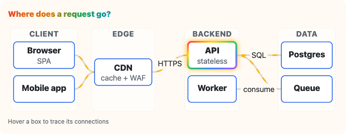
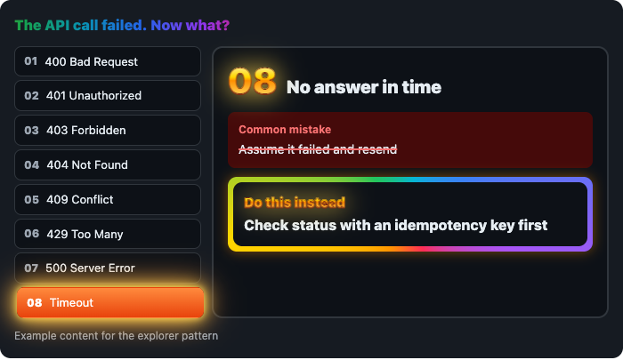
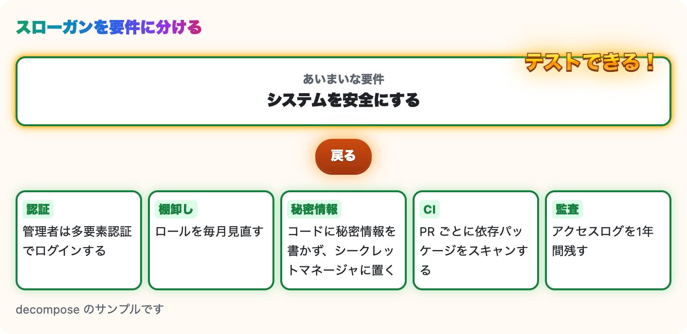
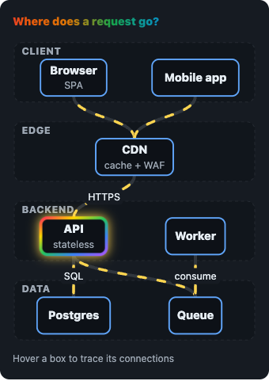

# dopamine-diagrams

[English](README.md) | **日本語**

ドパガキ向けの図を作るエージェントスキルです。Claude Code など、`SKILL.md` に対応したエージェントで使えます。

見出しには虹色のグラデーションが流れ、大事な言葉は金文字で光ります。いちばん見てほしい箱の周りは虹色の光が回り、クリックすると答えがハンコのようにドンと出ます。スクロールで読み飛ばされがちな図を、止まって見てもらうための見た目です。

HTML と CSS だけでできています。1つの JSON から、次の3通りに出力できます。

- **Zenn の `html-embed`** ブロック（JavaScript が使えない環境でもそのまま動きます）
- **単体の HTML** ページ
- **16:9 のスライド**（PDF に印刷できます）

検査スクリプトも付いています。出力を Chrome で開き、幅ごとに全部のボタンを押して、横のはみ出し、12px 未満の文字、Zenn の高さ上限500px、点滅とみなされる速さのアニメーションを見つけると FAIL にします。

<p>


</p>
<p>


</p>

## ドパガキって？

ドーパミン中毒のガキ、の略です。短い刺激に慣れていて、長い文章を読む前に離脱してしまう読者のことを、自虐も込めてこう呼んでいます。

このスキルの図は、もともと「【ドパガキ向け】AI 時代の要求管理 ハンドブックを読もう」という Zenn 記事のために作りました。派手な見た目は効きました。ただ、効いたのは、派手さを1〜2か所の焦点だけに使ったからです。全部を光らせると、ただのノイズになります。このスキルも「**焦点は1か所、残りは静かに**」というルールで作っています。

## 図の種類

| 種類 | 見せるもの | 操作 |
|---|---|---|
| `architecture` | 層ごとのコンポーネントと、リクエストの流れ | 接続線に光が流れる。箱にマウスを乗せると、つながる線だけが光る |
| `explorer` | 「X のときは Y する（Z ではない）」を複数の状況で | 状況を選ぶと、答えがスタンプで出る |
| `decompose` | ふわっとした一文を、具体的な項目に分解する | クリックで分解。項目が順に現れ、金色のスタンプが押される |
| `compare` | いつものやり方と、よりよいやり方 | クリックでビフォーがアフターに切り替わる |
| `loop` | 繰り返す循環と、目的まで戻るタイミング | 円に沿って光が流れる |
| `flow` | 一直線の手順 | 線に沿って光が流れる。手順を選ぶと説明が出る |
| `ladder` | 段階・成熟度・段階的な計画 | 自分の段を選ぶと、次の一手が金文字で出る |
| `proportion` | 平均に埋もれる、まれだけど大事な1件 | クリックで99個の点が薄れ、大事な1個が光る |

派手さの強さは3段階です。`1` は控えめ（社内資料や堅めの場向け）、`2` は標準、`3` は全開です。

## 導入

```sh
git clone https://github.com/muroshima/dopamine-diagrams ~/.claude/skills/dopamine-diagrams
cd ~/.claude/skills/dopamine-diagrams && npm run setup   # 任意。検査用（インストール済みの Chrome を使います）
```

あとはエージェントに頼むだけです。例えば「オンコールのエスカレーションルールを、dopamine-diagrams の explorer で Zenn 用に作って」と頼むと、エージェントが `SKILL.md` の手順に沿って作ります。出力先と図の種類を決めて、JSON を書き、組み立てて、検査して、見た目を確認する流れです。

## スクリプトを直接使う

```sh
python3 scripts/build.py examples/explorer.json --target zenn -o out.md
python3 scripts/build.py examples/*.json --target slides -o deck.html
python3 scripts/build.py examples/*.json --target standalone -o page.html --intensity 3
node scripts/check.mjs out.md --shots .check/out
node scripts/check.mjs deck.html --pdf deck.pdf
```

`build.py` は Python 3 だけで動きます（Windows では `python3` の代わりに `py`）。JSON に必須の項目がない、存在しない箱の id を指している、出力を壊す値が入っている、といった場合は、理由を表示して止まります。

`check.mjs` には、Node 18 以上と、`npm run setup`（playwright-core）、Google Chrome の安定版が必要です。Chromium など別の Chrome を使う場合は、`CHROME_PATH=/path/to/chrome` を指定してください。そろっていない場合は静的な検査だけを行い、その旨を表示します。`--shots DIR` を付けると、スクリーンショットを保存します。Zenn 向けは、700px と340px の幅で、ライトとダークそれぞれ状態ごとに1枚ずつ撮ります。単体 HTML とスライドは、最後のボタンを押したあとのページ全体を、幅とテーマごとに1枚撮ります。

## 演出のルール

- 点滅させません。0.5秒より速いループは使わず、光の強弱は1秒以上かけて変えます（Zenn は点滅する埋め込みを禁止しています。WCAG 2.3.1 の基準もあります）。
- 動きを減らす設定の閲覧者と印刷では、動きをすべて止めます。止めた状態でもすべて読めるように作っています。
- 表示される文字は12px 以上にします（縮小された SVG の文字も含みます）。色だけで区別しません。

## Zenn で使うときの注意

Zenn 公式は切り替えの境目を640px と案内しています。ただ、公開中の記事で実測すると、画面幅1440px と1280px では埋め込みの幅が706px なのに対し、1100px では591px、1024px では515px でした。この幅の範囲ではサイドバーが出て、本文の列が狭くなるためです。640px のままだと、よくある PC の画面幅でもスマホ用のレイアウトが出てしまいます。このスキルは境目を560px にしています。詳しくは [references/targets/zenn.md](references/targets/zenn.md) を見てください。

## ライセンス

MIT
