# dopamine-diagrams

**日本語** | [English](README.en.md)

ドパガキ向けの図を作るエージェントスキルです。Claude Code など、`SKILL.md` に対応したエージェントで使えます。


見出しには虹色のグラデーションが流れ、大事な言葉は金文字で光ります。いちばん見てほしい箱の周りを虹色の光が回り、クリックすると答えがハンコのようにドンと出ます。

HTML と CSS だけでできていて、1つの JSON から3通りに出力できます。

- **Zenn の `html-embed`** ブロック（JavaScript が使えない環境でもそのまま動きます）
- **単体の HTML** ページ
- **16:9 のスライド**（PDF に印刷できます）

## 図の種類

8種類あります。画像はどれも [examples/](examples/) のサンプルを Zenn の本文幅（706px）で撮ったものです。

### architecture: 層ごとのコンポーネントと、リクエストの流れ

接続線に光が流れます。箱にマウスを乗せると、つながる線だけが光ります（一番上の画像）。

### explorer: 「X のときは Y する（Z ではない）」を状況ごとに

状況を選ぶと、よくある間違いに取り消し線が引かれ、答えが虹色の枠の中にスタンプで出ます。状況ごとに重要度（★1〜4と言葉）のバッジも付けられます。

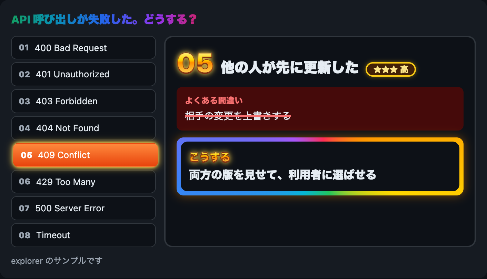

### decompose: ふわっとした一文を、具体的な項目に分解する

クリックで分解します。項目が順に現れ、最後に金色のスタンプが押されます。


### compare: いつものやり方と、よりよいやり方

クリックでビフォーがアフターに切り替わります。

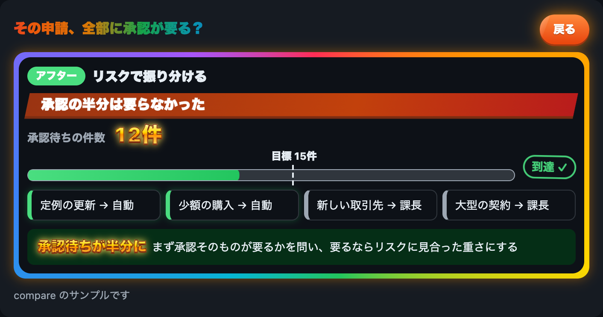

### loop: 繰り返す循環と、目的まで戻るタイミング

円に沿って光が回ります。点線の矢印は、目的が変わったら最初に戻る道です。

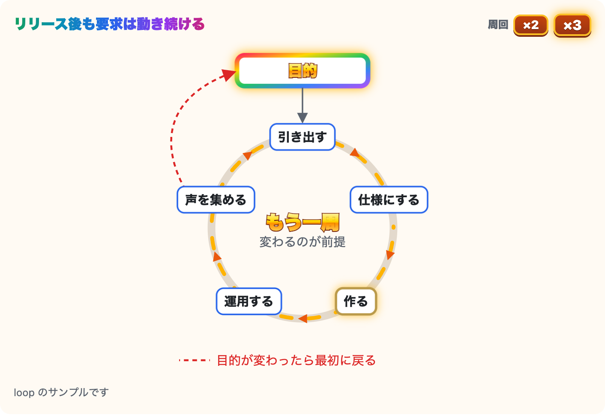

### flow: 一直線の手順

線に沿って光が流れます。手順を選ぶと説明が出ます。

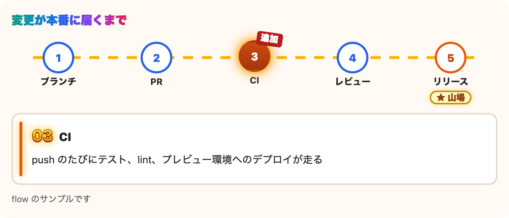

### ladder: 段階・成熟度・段階的な計画

自分の段を選ぶと、次の一手が金文字で出ます。

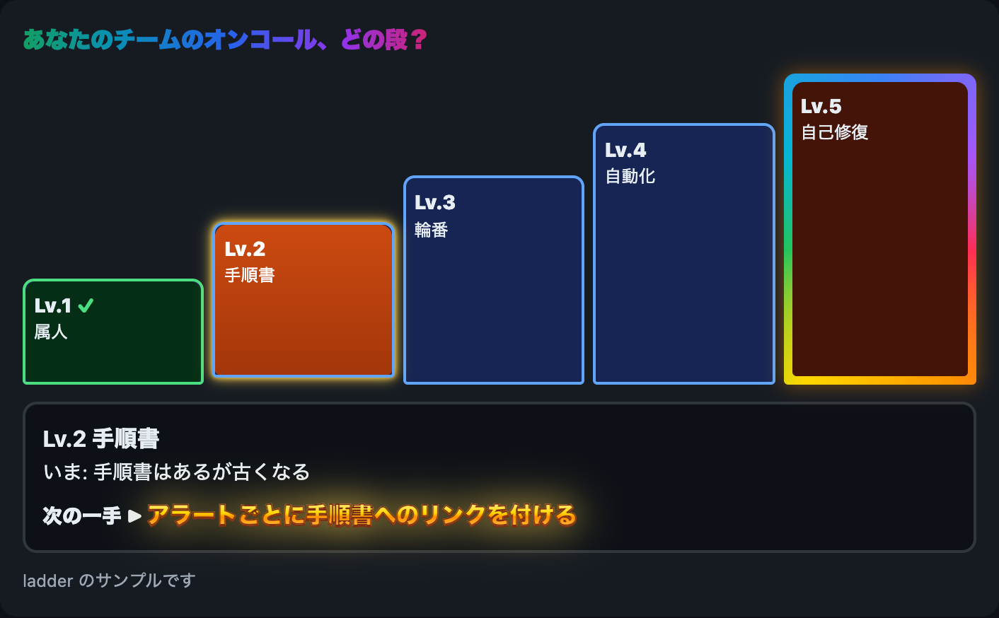

### proportion: 平均に埋もれる、まれだけど大事な1件

クリックで99個の点が薄れ、大事な1個が光ります。

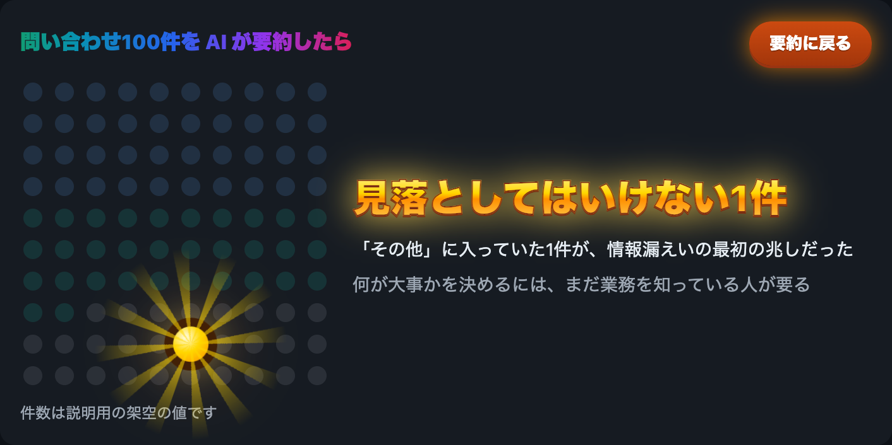

## スマホとスライド

画面が狭いと、レイアウトが縦に組み替わります。Zenn の埋め込みは幅560px で切り替えます（理由は下の「Zenn で使うときの注意」）。

<p>
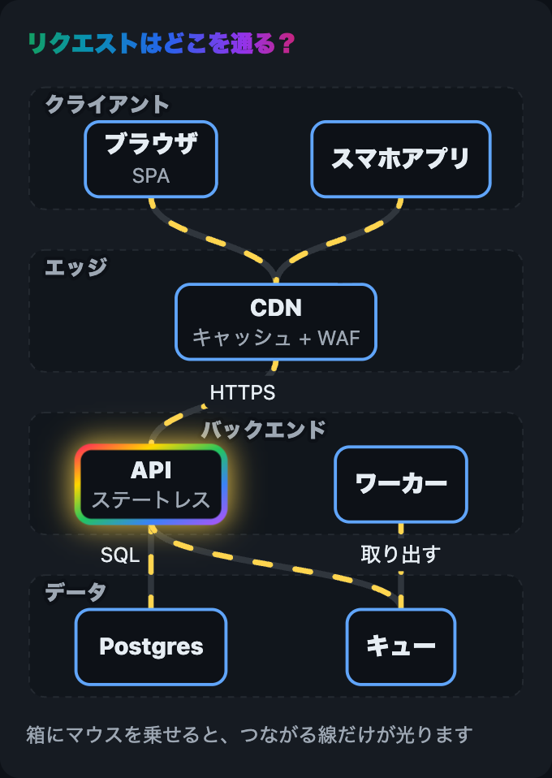
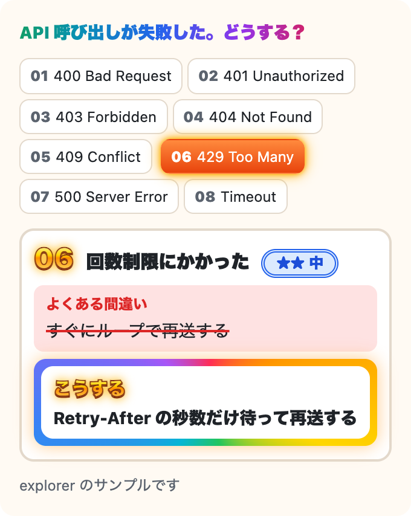
</p>

スライドは1枚1280×720px で、そのまま PDF に印刷できます。

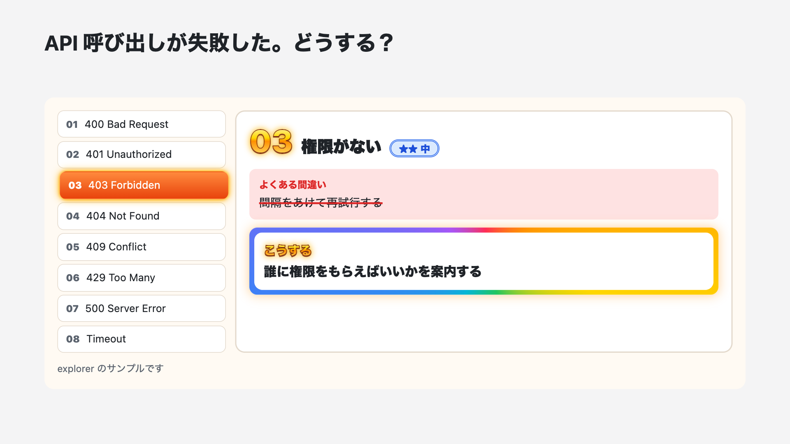

## 派手さの強さ

`--intensity` で3段階から選べます。左から `1`（控えめ。社内資料や堅めの場向け）、`2`（標準）、`3`（全開）です。

<p>
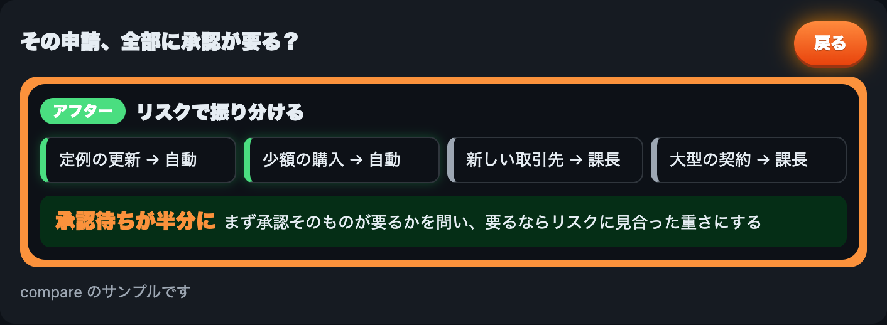

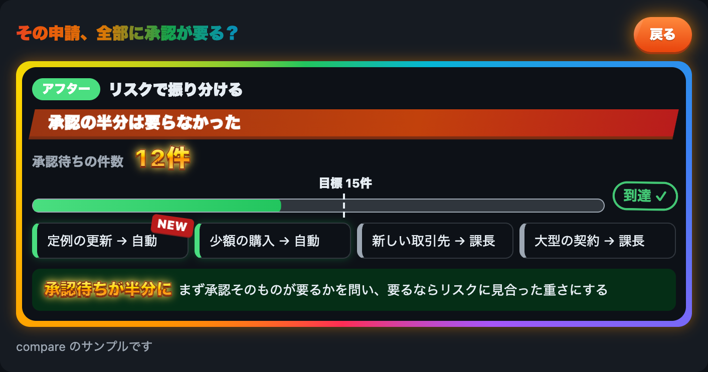
</p>

## 導入

```sh
git clone https://github.com/muroshima/dopamine-diagrams ~/.claude/skills/dopamine-diagrams
cd ~/.claude/skills/dopamine-diagrams && npm run setup   # 任意。検査用（インストール済みの Chrome を使います）
```

あとはエージェントに頼むだけです。例えば「オンコールのエスカレーションルールを、dopamine-diagrams の explorer で Zenn 用に作って」と頼むと、エージェントが `SKILL.md` の手順に沿って作ります。出力先と図の種類を決め、JSON を書き、組み立て、検査して、見た目を確認する流れです。

## スクリプトを直接使う

```sh
python3 scripts/build.py examples/explorer.json --target zenn -o out.md
python3 scripts/build.py examples/*.json --target slides -o deck.html
python3 scripts/build.py examples/*.json --target standalone -o page.html --intensity 3
node scripts/check.mjs out.md --shots .check/out
node scripts/check.mjs deck.html --pdf deck.pdf
```

`build.py` は Python 3 だけで動きます（Windows では `python3` の代わりに `py`）。JSON に必須の項目がない、存在しない箱の id を指している、出力を壊す値が入っている、といった場合は理由を表示して止まります。ボタンなどの既定の文言は、JSON にひらがなかカタカナがあれば日本語、なければ英語になります。`"lang": "ja"` か `"lang": "en"` で指定することもできます。漢字だけの日本語（「処理手順」など）は英語と判定されるので、その場合は `"lang": "ja"` を書いてください。英語のサンプルは [examples/en/](examples/en/) にあります。

`check.mjs` には Node 18 以上、`npm run setup`（playwright-core）、Google Chrome の安定版が必要です。Chromium など別の Chrome を使う場合は `CHROME_PATH=/path/to/chrome` を指定してください。そろっていなければ静的な検査だけを行い、その旨を表示します。

検査では出力を Chrome で開き、幅ごとに全部のボタンを押して確かめます。横のはみ出し、12px 未満の文字、Zenn の高さ上限500px、点滅とみなされる速さのアニメーションが見つかると FAIL です。`--shots DIR` を付けるとスクリーンショットも保存します。

## 演出のルール

- 光らせるのは1つの図に1〜2か所だけです。全部を光らせると、ただのノイズになります。
- 点滅させません。0.5秒より速いループは使わず、光の強弱は1秒以上かけて変えます（Zenn は点滅する埋め込みを禁止しています。WCAG 2.3.1 の基準もあります）。
- 動きを減らす設定の閲覧者と印刷では、動きをすべて止めます。止めた状態でもすべて読めます。
- 表示される文字は12px 以上にします（縮小された SVG の文字も含みます）。色だけで区別しません。

## Zenn で使うときの注意

Zenn 公式は切り替えの境目を640px と案内しています。ただ、公開中の記事で実測すると、埋め込みの幅は画面幅1440px と1280px で706px、1100px で591px、1024px で515px でした。この範囲ではサイドバーが出て、本文の列が狭くなるためです。640px のままだと、よくある PC の画面幅でもスマホ用のレイアウトが出てしまうので、このスキルは境目を560px にしています。詳しくは [references/targets/zenn.md](references/targets/zenn.md) を見てください。

## ライセンス

MIT
