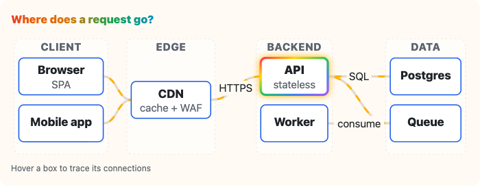
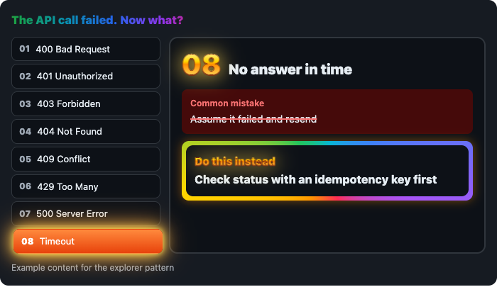
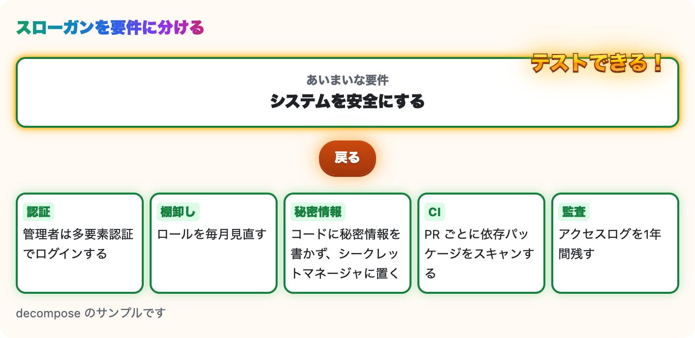
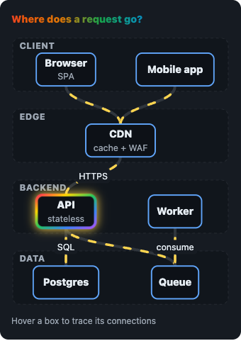

# dopamine-diagrams

**English** | [日本語](README.ja.md)

An agent skill (Claude Code and other `SKILL.md`-compatible agents) for explainer diagrams that people stop
scrolling for: flowing rainbow titles, gold text, a rainbow border running around the one box that matters,
neon pulses, and answers that stamp in when you click.

Pure HTML + CSS. One JSON spec builds to:

- a **Zenn `html-embed`** block (JavaScript is banned there; everything here works without it),
- a **standalone HTML** page,
- a **16:9 slide deck** that prints to PDF.

A render checker opens every output in Chrome, clicks every state at every width, and fails on overflow,
text under 12px, the 500px Zenn height limit, and animation loops fast enough to count as flashing.

<p>


</p>
<p>


</p>

## Why

The diagrams were first made for a Japanese article written *for "dopa-gaki"* — slang for readers hooked on
quick dopamine hits who will not read a paragraph. The loud look worked, but only because the loudness was
spent on one or two focal points. This skill keeps that rule: **one focal point, everything else calm**.

## Patterns

| Pattern | Shows | Interaction |
|---|---|---|
| `architecture` | Components in tiers, how a request flows | Light flows along edges; hover a box to light its connections |
| `explorer` | "In situation X, do Y (not Z)" | Pick a situation; the answer stamps in |
| `decompose` | A vague statement becoming concrete items | Click to break it down; pieces stamp in, a gold stamp lands |
| `compare` | The habit vs. the better way | Click to flip before into after |
| `loop` | A repeating cycle, and when to restart from the goal | Light runs round the ring |
| `flow` | Linear steps | Light runs along the line; pick a step |
| `ladder` | Levels, maturity, staged plans | Pick your level; the next move appears in gold |
| `proportion` | The rare case the average hides | One click fades 99 dots and lights up the one that matters |

Intensity: `1` calm (for conservative docs), `2` standard, `3` full.

## Install

```sh
git clone https://github.com/muroshima/dopamine-diagrams ~/.claude/skills/dopamine-diagrams
cd ~/.claude/skills/dopamine-diagrams && npm run setup   # optional: render checks (uses your installed Chrome)
```

Then ask your agent for a diagram, e.g. *"Make a dopamine-diagrams explorer for our on-call escalation rules,
for Zenn."* The agent follows `SKILL.md`: pick target and pattern, write a JSON spec, build, check, look.

## Use the scripts directly

```sh
python3 scripts/build.py examples/explorer.json --target zenn -o out.md
python3 scripts/build.py examples/*.json --target slides -o deck.html
python3 scripts/build.py examples/*.json --target standalone -o page.html --intensity 3
node scripts/check.mjs out.md --shots .check/out
node scripts/check.mjs deck.html --pdf deck.pdf
```

`build.py` needs only Python 3. `check.mjs` needs Node 18+, `npm run setup` (playwright-core) and Google Chrome;
without them it runs static checks only and says so.

## Rules the effects follow

- No flashing: no loop under 0.5s, glow eases over ≥ 1s (Zenn bans flashing embeds; WCAG 2.3.1).
- `prefers-reduced-motion` and print turn all motion off, and every element is readable without it.
- Rendered text ≥ 12px, including scaled SVG text. Colour is never the only signal.

## Layout

```
SKILL.md              workflow, emphasis budget, hard rules
references/           targets (zenn, slides, standalone), patterns, effects, interactions, pitfalls, citation
templates/            base.css (tokens + effects) and one CSS file per pattern
scripts/build.py      JSON spec -> zenn / standalone / slides
scripts/check.mjs     rendered checks
examples/             specs and built outputs
```

## License

MIT
